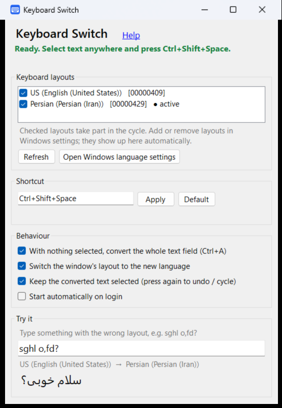

# Keyboard Switch

**Typed a whole sentence in the wrong keyboard layout? Select it, press one shortcut, done.**

```
sghl o,fd?   →   سلام خوبی؟
```

Keyboard Switch retypes the selected text as if the right layout had been active, switches the
layout of that window so you can keep typing, and keeps the result selected: press the shortcut
again to get the original back (or go on to the next layout if you use more than two).

It works with **any pair of keyboard layouts**: the key tables come from the operating system
itself, nothing is hard-coded. It was made for English ↔ Persian (فارسی), and has been tested with
the Windows *Persian* and *Persian (Standard)* layouts.

| | Windows 10 / 11 | Linux (KDE Plasma 6, Wayland) |
|---|---|---|
| Download / install | [`KeyboardSwitch.exe`](../../releases/latest) — a single 91 KB file, nothing to install | [`linux/install.sh`](linux) |
| Written in | C# (WinForms, .NET Framework 4.8 built into Windows) | Python, PyQt6, libxkbcommon |
| Details | [windows/README.md](windows/README.md) | [linux/README.md](linux/README.md) |



## Features

- One global shortcut (default `Ctrl+Alt+Space` on Windows), configurable.
- Detects which layout the text was typed in; cycles through the layouts you enable.
- Nothing selected? Converts the whole text field (optional).
- Your clipboard is saved and restored; the text is typed as Unicode, so it works whatever layout
  is active.
- Multi-line text is typed with Shift+Enter, so chat apps don't send the message halfway.
- Tray icon, start on login, built-in help and a "copy diagnostic info" button for bug reports.

## Is the Windows download safe?

The `.exe` isn't code-signed, so Windows SmartScreen may warn the first time
(*More info → Run anyway*). To check the file instead of trusting it:

- **It's built by GitHub from this repository**, not on someone's computer. Every release carries
  a [build provenance attestation](https://docs.github.com/actions/security-for-github-actions/using-artifact-attestations):
  ```sh
  gh attestation verify KeyboardSwitch.exe --repo haghdoostamir/keyboard-switch
  ```
- Compare the SHA256 with the `.sha256` file of the release:
  `Get-FileHash KeyboardSwitch.exe` in PowerShell.
- **Or build it yourself in seconds**: Windows already contains the C# compiler.
  ```powershell
  git clone https://github.com/haghdoostamir/keyboard-switch; cd keyboard-switch\windows
  powershell -ExecutionPolicy Bypass -File build.ps1 -Test
  ```

## Contributing

Bug reports and pull requests are welcome. For a problem on Windows, open *Help → Copy diagnostic
info* in the app and paste the result into the issue.

## License

[MIT](LICENSE) © 2026 Amir

---

<div dir="rtl">

## فارسی

**یک جمله را با کیبورد اشتباه تایپ کرده‌اید؟ انتخابش کنید و یک کلید میانبر بزنید.**

`sghl o,fd?` ← `سلام خوبی؟`

متن انتخاب‌شده دوباره تایپ می‌شود، انگار از اول با زبان درست تایپ کرده بودید. زبان کیبورد همان پنجره هم عوض می‌شود تا بتوانید ادامه دهید. اگر دوباره میانبر را بزنید، متن اصلی برمی‌گردد.

- **ویندوز ۱۰ و ۱۱:** فقط فایل [`KeyboardSwitch.exe`](../../releases/latest) را دانلود و اجرا کنید (۹۱ کیلوبایت، بدون نصب). میانبر پیش‌فرض `Ctrl+Alt+Space` است.
- **لینوکس (KDE Plasma 6 روی Wayland):** پوشهٔ [linux](linux) را ببینید.
- با هر دو زبانی کار می‌کند، چون جدول کلیدها از خود سیستم‌عامل خوانده می‌شود.
- بار اول ممکن است ویندوز پیام «Windows protected your PC» نشان دهد، چون فایل امضای دیجیتال ندارد: روی «More info» و بعد «Run anyway» بزنید. اگر فایل اجرا نشد: راست‌کلیک ← Properties ← تیک Unblock.
- راهنمای کامل داخل برنامه است (لینک Help). اگر مشکلی بود، دکمهٔ «Copy diagnostic info» را بزنید و متن را در بخش Issues بفرستید.

</div>
